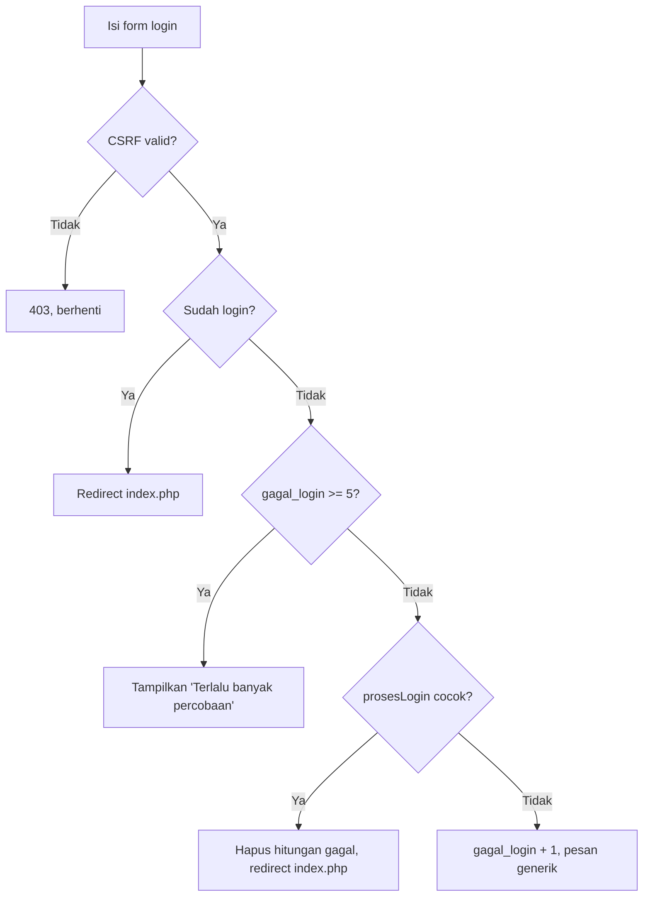
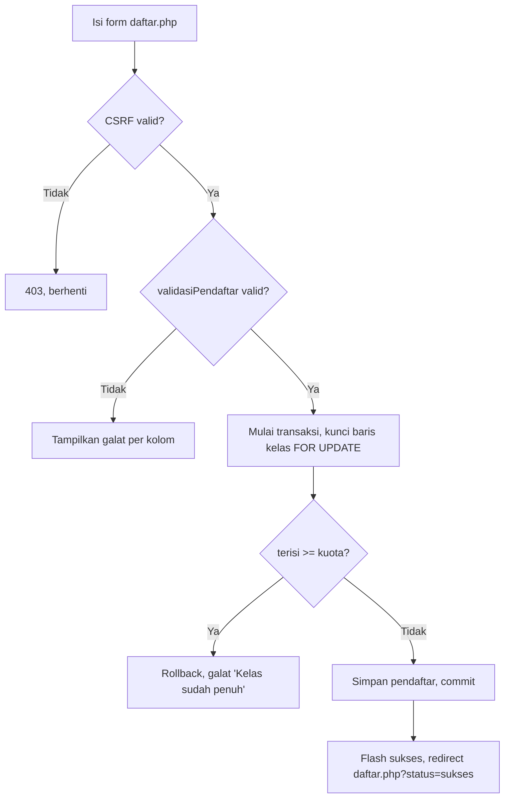

# Peta Modul — Sistem Pendaftaran Pelatihan (Hari 12, Lab 1)

Proyek: Proyek 5 Capstone, lanjutan Hari 9–11 di folder yang sama.
Sumber yang dipetakan: seluruh `src/` dan `public/` yang ada saat ini.
Tidak ada fungsi baru di Lab 1; yang berubah hanya komentar (lihat catatan di akhir).

## 1. Tabel berkas `src/`

| Berkas              | Tanggung jawab                                                                                                                                                              | Fungsi publik                                                                                                                                                                                                                                                                                   |
| ------------------- | --------------------------------------------------------------------------------------------------------------------------------------------------------------------------- | ----------------------------------------------------------------------------------------------------------------------------------------------------------------------------------------------------------------------------------------------------------------------------------------------- |
| `src/bootstrap.php` | Titik muat bersama: mulai sesi, muat konfigurasi, matikan/nyalakan tampil galat sesuai `debug`, muat `config/database.php` + semua `src/`, pasang penangan exception global | — (tidak ada fungsi; berisi `set_exception_handler`)                                                                                                                                                                                                                                            |
| `src/helpers.php`   | Utilitas umum dan keamanan: escape output, redirect, CSRF, flash message                                                                                                    | `e()`, `redirect()`, `tokenCsrf()`, `cekCsrf()`, `setFlash()`, `ambilFlash()`                                                                                                                                                                                                                   |
| `src/pendaftar.php` | Akses data dan aturan pendaftar: kelas, cari/paginasi, validasi, CRUD, bukti, dan kuota dengan transaksi                                                                    | `daftarKelas()`, `hitungPendaftar()`, `ambilPendaftar()`, `ambilPendaftarById()`, `emailSudahAda()`, `validasiPendaftar()`, `tambahPendaftar()`, `ubahPendaftar()`, `hapusPendaftar()`, `ambilSemuaPendaftar()`, `ambilBuktiPendaftar()`, `daftarkanDenganKuota()`; kelas `KuotaPenuhException` |
| `src/auth.php`      | Autentikasi admin berbasis sesi dan `password_hash`                                                                                                                         | `cariAdmin()`, `prosesLogin()`, `wajibLogin()`, `logout()`                                                                                                                                                                                                                                      |
| `src/validasi.php`  | Utilitas validasi dan format kecil yang dipakai di luar `validasiPendaftar()`                                                                                               | `validNoHp()`, `hitungSisaKuota()`, `formatNomorBukti()`                                                                                                                                                                                                                                        |

Catatan: `config/database.php` bukan bagian `src/`, tapi dipakai semua modul di atas:
`getConnection()` — koneksi PDO tunggal (static), `ERRMODE_EXCEPTION`,
`FETCH_ASSOC`, `EMULATE_PREPARES => false`.

## 2. Tabel berkas `public/`

| Berkas                    | Tanggung jawab                                                                                                                            | Akses                                                      |
| ------------------------- | ----------------------------------------------------------------------------------------------------------------------------------------- | ---------------------------------------------------------- |
| `public/index.php`        | Daftar pendaftar admin (DataTables, tombol Ubah/Cetak/Hapus)                                                                              | Admin, wajib login                                         |
| `public/tambah.php`       | Tambah pendaftar oleh admin (pakai `_form.php`, tanpa cek kuota transaksi)                                                                | Admin, wajib login                                         |
| `public/ubah.php`         | Ubah pendaftar, 404 bila ID tidak valid/tidak ada                                                                                         | Admin, wajib login                                         |
| `public/hapus.php`        | Hapus pendaftar, hanya POST + CSRF, 405 bila GET                                                                                          | Admin, wajib login                                         |
| `public/cetak.php`        | Cetak bukti pendaftaran PDF (Dompdf, kertas A5)                                                                                           | Admin, wajib login                                         |
| `public/daftar.php`       | Pendaftaran publik, satu-satunya jalur yang memakai cek kuota transaksi (`daftarkanDenganKuota()`)                                        | Publik, tanpa login                                        |
| `public/_form.php`        | Form bersama `tambah.php`, `ubah.php`, dan `daftar.php`; menampilkan sisa kuota tiap kelas                                                | Dipakai tiga halaman di atas                               |
| `public/login.php`        | Login admin, pesan galat generik, kunci setelah 5 kali gagal (`$_SESSION['gagal_login'] >= 5`), redirect ke `index.php` bila sudah login  | Publik                                                     |
| `public/logout.php`       | Logout, hanya POST + CSRF, 405 bila GET                                                                                                   | Admin (sesi aktif)                                         |
| `public/injeksi.php`      | Demo SQL injection (versi berbahaya vs prepared statement), HANYA latihan localhost                                                       | Publik, demo saja — bukan CRUD asli                        |
| `public/assets/js/app.js` | JS halaman: toast flash (SweetAlert2), konfirmasi hapus, DataTables (10 baris/halaman, bahasa Indonesia, kolom Aksi tidak bisa diurutkan) | — (tidak ada fungsi bernama; tiga blok `DOMContentLoaded`) |

## 3. Tabel parameter dan output — 5 fungsi

### 3.1 `validasiPendaftar()`

| Fungsi              | Parameter (tipe, makna, batasan)                                                                                                                                           | Nilai kembalian                                                                                                                                                               | Kasus khusus                                                                                                                                                                                                     |
| ------------------- | -------------------------------------------------------------------------------------------------------------------------------------------------------------------------- | ----------------------------------------------------------------------------------------------------------------------------------------------------------------------------- | ---------------------------------------------------------------------------------------------------------------------------------------------------------------------------------------------------------------- |
| `validasiPendaftar` | `array $input` — data mentah, biasanya `$_POST`; `PDO $pdo` — koneksi untuk cek email ganda dan daftar kelas; `?int $idUbah` — ID yang sedang diubah, `null` saat menambah | `array{data, galat}` — `data` sudah dibersihkan (nama di-trim, email di-lowercase + trim, `kelas_id` di-cast ke int); `galat` berisi pesan per kolom, kosong bila semua valid | `$idUbah = null` saat tambah; saat ubah, email milik pendaftar itu sendiri tidak dianggap ganda. Aturan: nama minimal 3 karakter, email valid, no HP `08` + 10–13 digit, `kelas_id` harus ada di `daftarKelas()` |

### 3.2 `ambilPendaftarById()`

| Fungsi               | Parameter (tipe, makna, batasan)                                                                                                     | Nilai kembalian                              | Kasus khusus                                                                                                                         |
| -------------------- | ------------------------------------------------------------------------------------------------------------------------------------ | -------------------------------------------- | ------------------------------------------------------------------------------------------------------------------------------------ |
| `ambilPendaftarById` | `PDO $pdo` — koneksi aktif; `int $id` — ID pendaftar, minimal 1 (pemanggil memvalidasi dengan `FILTER_VALIDATE_INT` + `min_range 1`) | `?array` — satu baris pendaftar (`SELECT *`) | `null` bila tidak ditemukan (hasil `fetch()` = `false` diubah jadi `null`); pemanggil (`ubah.php`, `cetak.php`) mengubahnya jadi 404 |

### 3.3 `daftarkanDenganKuota()`

| Fungsi                 | Parameter (tipe, makna, batasan)                                                                                                       | Nilai kembalian                           | Kasus khusus                                                                                                                                                                                                                            |
| ---------------------- | -------------------------------------------------------------------------------------------------------------------------------------- | ----------------------------------------- | --------------------------------------------------------------------------------------------------------------------------------------------------------------------------------------------------------------------------------------- |
| `daftarkanDenganKuota` | `PDO $pdo` — koneksi aktif; `array $data` — data SUDAH tervalidasi dari `validasiPendaftar()` (`nama, email, no_hp, alamat, kelas_id`) | `void` — tidak mengembalikan ID pendaftar | Melempar `KuotaPenuhException` bila jumlah pendaftar kelas sudah `>= kuota`; melempar `PDOException` bila query gagal (transaksi di-rollback). Fungsi ini TIDAK memvalidasi ulang isi form — validasi tetap tugas `validasiPendaftar()` |

### 3.4 `prosesLogin()`

| Fungsi        | Parameter (tipe, makna, batasan)                                                                                                                                           | Nilai kembalian                                                                                                                                                      | Kasus khusus                                                                                                                                                                                                                      |
| ------------- | -------------------------------------------------------------------------------------------------------------------------------------------------------------------------- | -------------------------------------------------------------------------------------------------------------------------------------------------------------------- | --------------------------------------------------------------------------------------------------------------------------------------------------------------------------------------------------------------------------------- |
| `prosesLogin` | `PDO $pdo` — koneksi aktif; `string $username` — sudah di-trim oleh `login.php`; `string $sandi` — kata sandi mentah dari form (tidak pernah disimpan, hanya diverifikasi) | `bool` — `true` bila admin ditemukan DAN `password_verify()` cocok; efek samping: regenerasi ID sesi + isi `$_SESSION['admin_id']` dan `$_SESSION['admin_username']` | `false` untuk kedua kasus (username tidak ada ATAU sandi salah) — sengaja tidak dibedakan, supaya penyerang tidak bisa menebak username yang ada. Hitungan gagal dan pesan kunci (`>= 5`) bukan di sini, melainkan di `login.php` |

### 3.5 `daftarKelas()`

| Fungsi        | Parameter (tipe, makna, batasan) | Nilai kembalian                                                                                                                                                           | Kasus khusus                                                                                                                                                                                                        |
| ------------- | -------------------------------- | ------------------------------------------------------------------------------------------------------------------------------------------------------------------------- | ------------------------------------------------------------------------------------------------------------------------------------------------------------------------------------------------------------------- |
| `daftarKelas` | `PDO $pdo` — koneksi aktif       | `array` — tiap baris: `id, nama_kelas, kuota, terisi` (terisi = `COUNT(pendaftar)`, `LEFT JOIN` sehingga kelas kosong tetap tampil dengan terisi 0), diurutkan nama kelas | Array kosong bila belum ada kelas. Angka `terisi` di sini HANYA untuk tampilan sisa di form — keputusan kuota yang mengikat ada di `daftarkanDenganKuota()` (transaksi + `FOR UPDATE`), bukan di angka tampilan ini |

## 4. Pseudocode dan diagram alur

### 4.1 Alur login

Pseudocode:

```
BACA username, sandi dari form (cek CSRF dulu)
JIKA sudah ada sesi admin MAKA redirect ke index.php, SELESAI
JIKA gagal_login >= 5 MAKA tampilkan 'Terlalu banyak percobaan', SELESAI
JIKA prosesLogin() = true MAKA
    hapus hitungan gagal_login
    redirect ke index.php
SELAIN ITU
    gagal_login = gagal_login + 1
    tampilkan pesan generik 'Username atau kata sandi salah.'
SELESAI
```

Diagram Mermaid:



### 4.2 Alur pendaftaran (publik, `daftar.php`)

Pseudocode:

```
BACA data form (cek CSRF dulu)
HASIL = validasiPendaftar(data, null)
JIKA HASIL.galat tidak kosong MAKA tampilkan galat per kolom, SELESAI
COBA daftarkanDenganKuota(data)
    MULAI transaksi
    KUNCI baris kelas (FOR UPDATE)
    JIKA jumlah pendaftar >= kuota MAKA batalkan, lempar KuotaPenuhException
    SIMPAN pendaftar
    SELESAI transaksi
TANGKAP KuotaPenuhException MAKA tampilkan galat di kolom kelas, SELESAI
JIKA berhasil MAKA flash 'Pendaftaran berhasil', redirect daftar.php?status=sukses
SELESAI
```

Diagram Mermaid:



## 5. Tinjauan komentar (Lab 1 langkah 3)

Hasil tinjauan seluruh `src/` dan `public/`:

- Tidak ada komentar yang mengulang kode baris-per-baris (`$i++; // tambah i`) untuk dihapus;
  komentar yang ada sudah menjelaskan alasan/aturan (mis. `FOR UPDATE` anti race condition,
  pesan login generik, demo injeksi hanya localhost). Jadi tidak ada komentar yang dihapus.
- Tidak ditemukan komentar usang yang bertentangan dengan kode saat ini.
- Yang ditambahkan di Lab 1 ini (hanya komentar, logika TIDAK diubah):
  1. Validasi kuota — `src/validasi.php` (`hitungSisaKuota()`): sisa di form hanya tampilan,
     keputusan mengikat tetap di transaksi; dan `public/daftar.php` (blok catch).
  2. Login — `src/auth.php` (`prosesLogin()`): alasan regenerasi ID sesi (cegah session
     fixation) dan alasan return `false` generik (tidak membocorkan username yang ada).
  3. `daftarkanDenganKuota()` — `src/pendaftar.php` (blok catch): alasan rollback
     (tidak tersimpan sebagian) dan alasan lempar ulang exception (supaya pemanggil
     bisa membedakan kuota penuh dari galat lain).
  4. Semua blok catch dalam cakupan `src/` + `public/` sudah diberi komentar alasan —
     jumlahnya hanya 2: `catch (Throwable)` di `daftarkanDenganKuota()` dan
     `catch (KuotaPenuhException)` di `daftar.php`. Penangan exception global di
     `src/bootstrap.php` (`set_exception_handler`) bukan blok catch, jadi tidak
     dihitung, tapi pesannya sudah generik (tidak membocorkan detail galat ke browser).
- File lain dibiarkan apa adanya, sesuai cakupan Lab 1.
  